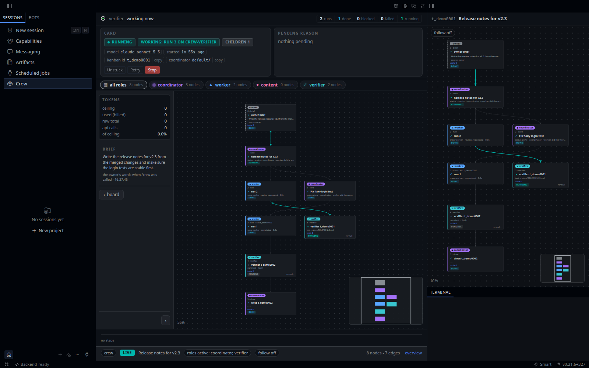

# Hermes.Crew

**You ask once. A coordinator owns the card until its proof passes.**

[](https://github.com/NousResearch/hermes-agent)
[](plugin.yaml)
[](https://github.com/macd2/Crew/actions/workflows/tests.yml)
[](LICENSE)
[](https://www.python.org/)
[](https://crew.forgecoreai.com)


[Website](https://crew.forgecoreai.com) · [Watch the 53 s film](https://crew.forgecoreai.com/#board) · [Install](#install) · [Windows](WINDOWS.md) · [Hermes Desktop](#crew-in-hermes-desktop) · [Commercial](#commercial-services) · [Reference](REFERENCE.md)

---

Crew is a plugin for [Hermes Agent](https://github.com/NousResearch/hermes-agent) that turns one chat
message into verified work on the Hermes kanban board.

```
/crew launch the Pro plan: pricing page, Stripe checkout, launch post and email
```

Crew asks only what it needs to deliver a good result (five questions at most, often none), writes a
**card contract** - goal, artifact, where it lands, *done when*, a **proof command**, a token budget - and
hands the card to a **coordinator** that owns it until the proof command exits 0. You get the verified
result back in the same chat, or one concrete question when it truly needs you.

[](https://crew.forgecoreai.com)

## What's new in 0.10.0

- **Native Desktop UI.** Crew is a page of Hermes Desktop itself, not a frame around a web page: board, card page and
  flow graph in the app's colours, light and dark.
- **The Crew flow pane**, following the live card, with a selector when several cards run.
- **A button bar on every card**: Unstuck, Retry, Stop and Open chat, the same commands as the slash commands; **Proof** appears only when the card has a proof question waiting.
- **Chat-style transcripts** in the Desktop card page: lists and code fences keep their shape.
- **One UI in three places.** The browser dashboard, the Hermes web UI tab and Desktop run the same app, built from
  one source (`ui/`).
- Since 0.9.13: the roles use native tools (`crew_verdict`, `crew_progress`, ...) instead of shell lines.

See [Crew in Hermes Desktop](#crew-in-hermes-desktop).

## Why

| | |
|---|---|
| **One ask** | `/crew <ask>` is the only thing you type. Normal chat stays untouched. |
| **Up to six cards in parallel** | One ask fans out into independent cards, one writer each. |
| **Done means proven** | A card cannot be marked done until its proof command passes - enforced by a tool guard, in every profile. |
| **An owner for every card** | The coordinator heals, retries, rescopes or splits a stuck card, and asks you only when it needs you. |
| **Hard budgets** | Every card carries a token budget; a run that reaches it stops instead of burning on. |
| **See everything** | A local dashboard shows every card, run, session, tool call and verdict, live. |
| **Self-hosted** | Runs inside your own Hermes, on your own machine. No telemetry. |

## Commercial Services

Crew is free and open source, Apache-2.0. If you use it in an enterprise and would benefit from
commercial support, additional tooling, or managed model spending, write to
[crew@forgecoreai.com](mailto:crew@forgecoreai.com).

## Install

Requires Hermes Agent **0.21.5 or newer** with the kanban board, and Python 3.11+. The plugin declares
`requires_hermes: ">=0.21.5"`, so an older Hermes refuses to load it instead of failing half-way. From 0.8.0 crew
runs on Hermes's package-manager dependency layout (the gateway's bare interpreter plus a committed venv) as well
as the older in-tree venv; 0.7.x only knew the latter, and a `hermes update` onto the new layout broke its proofs.

```sh
# 1. get the plugin
hermes plugins install macd2/Crew

# 2. set it up for your chat profile (role profiles, the dashboard service)
python3 ~/.hermes/plugins/crew/install.py --profile NAME

# 3. check it
python3 ~/.hermes/plugins/crew/install.py --check --profile NAME
hermes -p NAME plugins doctor crew
```

`NAME` is the profile you chat with (`default` if you do not use profiles). Running the installer twice
changes nothing; `--check` is a dry run that prints exactly what would change. The installer never asks
anything and never approves a shell hook for you.

> **On Windows?** Native Windows is supported with [Git for Windows](https://git-scm.com/download/win)
> installed (proofs run in Git Bash). It has no systemd or cron, so the graph-http service and
> `--nightly-proofs` are skipped there. Use WSL if you want both unchanged. See **[WINDOWS.md](WINDOWS.md)**.

### What `install.py` changes

By default:

- **Role profiles.** Creates `crew-coordinator`, `crew-worker`, `crew-content` and `crew-verifier` with
  `hermes profile create --clone-from NAME`. Hermes has no partial clone, so each role profile gets a copy of
  your profile's `config.yaml` (including its `hooks:`), its whole `.env` (provider keys), `SOUL.md`, skills
  and memories (`MEMORY.md`, `USER.md`); Hermes strips the messaging channels. Then, in each role profile:
  - sets the keys from `templates/profiles/<role>/settings.conf` with `hermes config set`. Models are
    Anthropic's, and `model.base_url` is pinned to `https://api.anthropic.com`: edit the template before
    installing to use your own;
  - replaces `SOUL.md` with the role's persona (only while it is still the shipped one);
  - deletes every skill that is not crew's, printing each path. This only happens in a role profile crew
    created (it carries `crew/template-shipped.json`);
  - installs the plugin, skills and roles file, and runs `plugins enable crew --no-allow-tool-override`.
- **Your profile.** Copies the plugin (with its `scripts/`) to `<profile>/plugins/crew/`, the skills to
  `skills/crew/` and the roles file to `roles/crew/`; sets `crew.roles_path` and `crew.source_dir`; records
  the owner profile in `~/.hermes/crew/owner.json`.
- **Other profiles that already have crew.** Each is updated to the same version (plugin, skills, roles), and
  every update is printed. Profiles without crew are not touched.
- **Old copies.** Deletes the crew scripts earlier versions put in `<profile>/scripts/`, only the files crew
  shipped, printing each one, and retires the old self-heal and observer cron jobs.
- **Dashboard.** Writes and starts the user service `crew-graph-http` (`Restart=always`), bound to
  `127.0.0.1:8799` (`--graph-port N`). `--no-service` skips it.

Only when you ask for it:

| Flag | What it adds |
|---|---|
| `--nightly-proofs` | A Hermes cron job at 03:00 that runs the proof suite and speaks only on a failure, plus the shim `<profile>/scripts/crew_proofs_nightly.py` (Hermes cron runs scripts from there only, and runs a `.py` one with Hermes's own interpreter, which the proofs need; an older `crew_proofs.sh` shim is migrated and removed). Output stays local unless `--proofs-deliver TARGET`. |
| `--chat-kanban` | Enables the kanban toolset on the zulip and telegram platforms of your profile. |
| `--telegram-menu` | Puts the crew commands first in your Telegram command menu. |
| `--spill-cap` | Sets `hooks.output_spill.max_chars` on your profile, so the `/crew` intake reads its brief in one tool call. |
| `--publish` | Serves the dashboard on your tailnet with `tailscale serve` (tailnet only, never the internet). Only one tailnet login gets in (`--publish-user LOGIN`, or the tailnet's single human login; otherwise it refuses), plus devices with a tag from `--publish-tag` (a tagged device carries no login). |

The installer reports shell hooks your profiles declare but you have not approved. It never approves them:
review them with `hermes -p P hooks list` and confirm them at Hermes's own prompt.

## Crew in Hermes Desktop



Hermes Desktop gets a **Crew** page in its sidebar, built from the same app as the browser dashboard and drawn with
the app's own colours. It needs no separate server and no systemd, so it works on Windows too.

**What you get**

- **The native board.** Every card by lane, the counts, the notes bell with its acknowledge buttons.
- **The card page with its flow graph.** Steps, findings, proof and verdict, and the graph of the card's runs,
  sessions and subagents, live. No iframe: it is part of the app.
- **The Crew flow pane.** A pane on the right that shows the graph of the card the crew is working on right now and
  follows it from card to card. When several cards run at once the pane header shows a selector (short id and title);
  your pick is kept until that card stops, then the pane falls back to the first live one.
- **The card's button bar.** **Unstuck**, **Retry** and **Stop** act on the card (Stop asks first, in the
  app's own confirm dialog); each is on only when the card's state allows it. **Proof** is drawn only when the card has a
  proof question waiting, and then it is on. **Open chat** opens the coordinator's session in its own window. On the
  board, the cards in the Needs-you lane carry **Unstuck** and **Retry** too (and **Proof** under the same rule); no
  other lane's tiles have buttons.
- **A popup when a card needs you.** When a card newly lands in Needs you, Crew shows a Desktop toast (and the OS
  notification while you are away) with an **Open in Crew** button that opens that card's page. Desktop's own Kanban
  toast, if you enabled the Kanban plugin, still opens the Kanban board; a plugin cannot redirect it.
- **Chat-style transcripts.** A run's own words are drawn by the app's chat renderer: lists, code blocks, links and
  inline code look as they do in a chat.
- **Light and dark follow the app.** Switch the app's mode and Crew switches with it.
- **One Kanban row.** Crew hides the app's Kanban row while it is enabled; the switch in the Crew header brings it back.

**Set it up**

1. Install crew into the profile Desktop starts with, as in [Install](#install) (on Windows see
   [WINDOWS.md](WINDOWS.md)); with one profile that is `default`. Desktop mounts the Crew page's data from the profile it
   was launched with, not the one you switch to inside the app: if you use another profile, either install crew there
   too or start Desktop with the profile crew is in (point `HERMES_HOME` at that profile's folder when you launch it).
   Desktop remembers the profile you last picked in its profile rail and uses it from the next launch, so restart
   Desktop after switching.
2. Enable the plugin: the installer already runs `hermes plugins enable crew`, which puts `crew` in `plugins.enabled`
   of the profile's `config.yaml` (check with `hermes -p NAME plugins list`).
3. In Desktop open **Capabilities > Plugins** and press **Rescan**. Desktop plugins are opt-in, so switch on crew's
   desktop half there too (switching the agent half on also switches its Desktop half on).
4. **Crew** appears in the sidebar.

**If the page says `Crew could not load: 404 Not Found`**, Desktop is running a profile that has no crew (or an
older crew without the Desktop half): the plugin's data routes are mounted from the launch profile only. Install crew
into that profile, or relaunch Desktop with the profile crew is in, then Rescan.

**Setting this up with an agent?** Run `hermes profile list` to see the profiles, then read the Hermes docs on
[Desktop profiles](https://hermes-agent.nousresearch.com/docs/user-guide/desktop#sessions--profiles) and
[profiles](https://hermes-agent.nousresearch.com/docs/user-guide/profiles).

### Two modes

Crew has one interface and two ways to run it, in plain words:

- **Terminal (no Desktop).** Install as usual and keep the browser dashboard: same URL (`http://127.0.0.1:8799`),
  same `crew-graph-http` unit, same look. What changed is that it now serves one React app instead of three scripts.
- **Hermes Desktop.** The same app, native in the sidebar, with the flow pane and the button bar. It needs no daemon:
  Desktop's own backend serves crew's data.

Both read the same kanban board and the same session store, so a card looks the same in either, and you can use both
at once. The **Hermes web UI** dashboard tab runs the same app too.

## Use

| Command | What it does |
|---|---|
| `/crew <ask>` | The intake: asks what is missing, writes the contract, opens the card(s). |
| *(reply to a crew report)* | Answer the card-ended message crew posts into your chat with "rework it" and the intake runs for a follow-up card, no `/crew` retyped (your next message only, within 30 min). |
| `/crew-status` | Cards in flight, the coordinator's last decision, any question for you. No model call. |
| `/crew-graph <card\|latest>` | One card's flow graph in the terminal (`--watch N`, `--html`). No model call. |
| `/crew-stop [<card>]` | Park one card, or every open crew card: worker killed, card held with its history, nothing archived. `--archive <card>` drops one for good. No model call. |
| `/crew-unstuck <card>` | Put a card the coordinator gave up on, or one you parked with `/crew-stop`, back in the queue (out of triage unchanged, or unblocked). No model call. |
| `/crew-safety [brave\|safe]` | Show or set how careful unattended proof commands are (see below). No model call. |
| `/crew-proof <card> <yes\|brave>` | Answer a card's proof question: `yes` accepts a proposed proof command, `brave` runs a blocked one. No model call. |
| `/crew-diagnose [state]` | Read-only: every card in that state, why it is there and how it would resume. |

Or paste this into an agent and let it set crew up for you:

```
Set up Hermes.Crew for my Hermes profile NAME: from the Hermes.Crew package run python3 install.py --profile NAME,
then hermes -p NAME plugins doctor crew and fix anything it reports. Finish by sending /crew-status in my chat
and tell me what it answered.
```

## The roles' tools

The roles do not shell out to `crew_card.py`. The plugin registers 17 tools in the `crew` toolset across Core, Pipeline, Workspace, Intelligence, and Helpers, declared in `plugin.yaml` and documented in the role skills:

### Core Tools (5)
- `crew_card_create`: create a guarded, contract-validated Crew card directly in Turn 1 (replaces raw `kanban_create`).
- `crew_diagnose`: read-only diagnostic reader for stuck, blocked, or in-flight cards across states.
- `crew_verdict`: run the card's owner-confirmed proof command unattended and record the PASS/FAIL line in the verdict log.
- `crew_status`: query board and card state, metrics, and queue status across roles.
- `crew_event_subscribe`: manage webhook subscriptions for card lifecycle events.

### Pipeline & Workflow Tools (4)
- `crew_stop_card`: park or archive active or queued cards safely.
- `crew_review_handoff`: transition completed work to the `review` column for independent, dual, or agent verification.
- `crew_request_changes`: return a card from review back to the implementer with actionable rejection reasons.
- `crew_plan_split`: split a complex plan into parent, child cards, and a closeout aggregator.

### Workspace & Isolation Tools (2)
- `crew_worktree_create`: create an isolated git worktree under `O:/workspaces/.worktrees/<name>` to enforce Zero-Checkout.
- `crew_worktree_cleanup`: remove an isolated worktree and branch cleanly after completion/merge.

### Intelligence & Self-Improvement Tools (2)
- `crew_flow_graph`: generate deterministic visual dependency graphs in Mermaid or JSON format.
- `crew_lesson_record`: structured lesson recording with validation against schema rules and role retrieval.

### Script & Progress Helpers (4)
- `crew_progress`: mark units pass/fail with raw line evidence on multi-unit deliverables.
- `crew_proof_check`: pre-screen proposed proof commands for danger and read the safety mode.
- `crew_lesson`: quick lesson recording for roles.
- `crew_plan`: open a parent card with children and closeout from a plan spec object.

### Role Mapping
- **Coordinator**: `crew_card_create`, `crew_proof_check`, `crew_plan`, `crew_plan_split`, `crew_stop_card`, `crew_status`, `crew_diagnose`, `crew_event_subscribe`, `crew_flow_graph`, `crew_lesson_record`, `crew_lesson`.
- **Worker**: `crew_verdict`, `crew_review_handoff`, `crew_worktree_create`, `crew_worktree_cleanup`, `crew_progress`, `crew_status`, `crew_flow_graph`, `crew_stop_card`, `crew_lesson_record`, `crew_lesson`.
- **Content**: `crew_verdict`, `crew_review_handoff`, `crew_progress`, `crew_status`, `crew_flow_graph`, `crew_lesson_record`, `crew_lesson`.
- **Verifier**: `crew_verdict`, `crew_request_changes`, `crew_progress`, `crew_worktree_create`, `crew_worktree_cleanup`, `crew_status`, `crew_flow_graph`, `crew_lesson_record`, `crew_lesson`.

## Self-improvement

What agents learn on a card lives in `<base home>/crew/lessons.md`, one dated line per lesson with the roles it
applies to. It is never shipped and the installer and `crew_parity_check` leave it alone. Agents record a lesson
with the `crew_lesson` tool (`role`, `text`; for example role `content,verifier`)
(identical lessons are stored once; the newest 50 entries / 8 KB are kept); editing a crew skill with
`skill_manage` is refused in every profile, because an installed skill is overwritten by the next install.
The plugin adds a role's lessons (and the `all` ones) to that role's turn, and the `all` ones to `/crew`'s intake.
An agent may not write `--role all` lessons (that is the owner's intake channel); it tags its own role and the
owner promotes it. To make a lesson permanent, move it into the matching `skills/*/SKILL.md` in a release and delete it from the file.

## Proof safety

A proof command is a shell command, and crew runs it unattended. When the intake shows you the proof, it asks
once:

```
Proof commands run unattended. How careful should crew be?

  1) Hermes safety (default): a flagged command (rm, chmod, a download piped into a shell, ...)
     stops the card and asks you.
  2) Be brave 🫡 (YOLO): nothing stops a proof except Hermes's hardline list
     (wiping the root, formatting a disk, fork bombs). Crew will happily rm what the proof says.
     Your call, your disk.
```

- **The command you confirm is the only one that runs.** It is saved when the card opens. Editing the card,
  or a coordinator rescope, cannot change it; a new proof needs your yes again.
- **Hermes decides what is dangerous.** Crew uses Hermes's own checks: the hardline list and your
  `approvals.deny` rules always block; in safe mode Hermes's dangerous-command and tirith checks block too.
  If the proof you are confirming would be flagged, the card opens in safe mode and the coordinator asks you;
  answer `/crew-proof <card> brave` to run it for that card. The intake's own `Proof mode` / `Proof approved`
  body lines are ignored for a flagged command, so a model cannot approve it on your behalf.
- **Proofs run with a clean environment.** Provider and tool keys are stripped, the same way Hermes's
  terminal tool does it.
- **`/crew-safety brave` stops the question for good.** It sets Hermes's `approvals.mode: off` in the crew
  role profiles, which also lets the workers' own terminal commands run unprompted. `/crew-safety safe` puts
  back the value each profile had before.

Proof scripts are model-written (by the verifier role, never by the writer). The command that runs them is
owner-confirmed; the script runs with a scrubbed environment, is bound by hash after its first run, and changes only
through a coordinator decision carried out by the verifier. Hermes's command checks see the command, not the script's
content.

## Reports

Crew reports back into the chat a card came from, through Hermes's own `hermes send` (any platform Hermes is
connected to), and only when there is something to say: one report when a card is done, one message per new
question for you, one line if a card is abandoned. Blocks, retries and heals the coordinator is handling stay
silent.

## How a card travels

```
you ──/crew──▶ intake ──contract──▶ coordinator ──▶ writer (worker | content) ──▶ proof ──▶ verifier ──▶ you
                (asks what is        (owns the card,    (one per card,            (exit 0 is    (runs the proof
                 missing, once)       every stop gets    inside the scope)         the only      itself, never
                                      one decision)                                pass)         trusts a summary)
```

The full design - the contract fields, the close rule, verification modes, the coordinator's decisions,
the dashboard and the role profiles - is in [REFERENCE.md](REFERENCE.md).

## Configuration

Everything works with no configuration. Optional environment variables:

| Variable | Default | Meaning |
|---|---|---|
| `CREW_OWNER_PROFILE` | the profile `install.py` was run for | the chat profile cards are opened from and reported to |
| `CREW_DASHBOARD_URL` | `http://127.0.0.1:8799` (or the `--publish` URL) | the board link used in messages |

## Uninstall

```sh
hermes plugins disable crew && hermes plugins remove crew
systemctl --user disable --now crew-graph-http.service
```

The role profiles stay until you remove them (`hermes profile delete crew-worker`, ...). With
`--nightly-proofs`, also remove the cron job (`hermes cron list`, `hermes cron remove <id>`) and
`<profile>/scripts/crew_proofs_nightly.py`.

## Contributing

Pull requests run the test suite in GitHub Actions (Python 3.11 and 3.12). Please keep `python -m pytest tests -q` green; a first-time contributor's run starts after a maintainer approves it.

The interface lives in `ui/`: TSX source, built with esbuild into two generated files that are committed, `desktop/plugin.js`
(Hermes Desktop) and `scripts/crew_dashboard/app.js` (the browser dashboard and the Hermes web UI tab). Never edit
those two by hand. After changing `ui/src`, run `npm ci --prefix ui` once, then `node ui/build.mjs` to regenerate them;
`node ui/build.mjs --check` fails when a generated file is stale (the plugin version from `plugin.yaml` is embedded, so a version bump needs a rebuild), and it runs in CI and in the publish gate (the old
`board.js`, `card.js` and `crew.css` are gone). `ui/node_modules/.bin/tsc -p ui` type-checks the source.

## License

[Apache-2.0](LICENSE) © macd2
