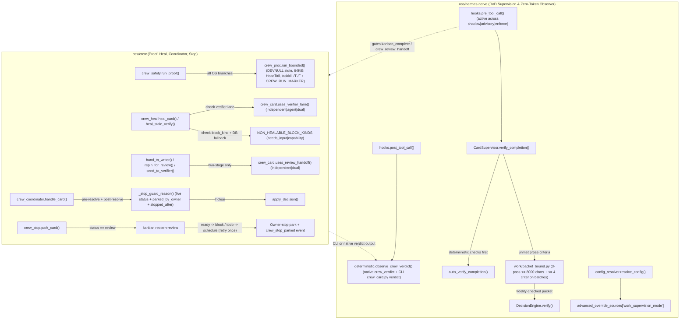
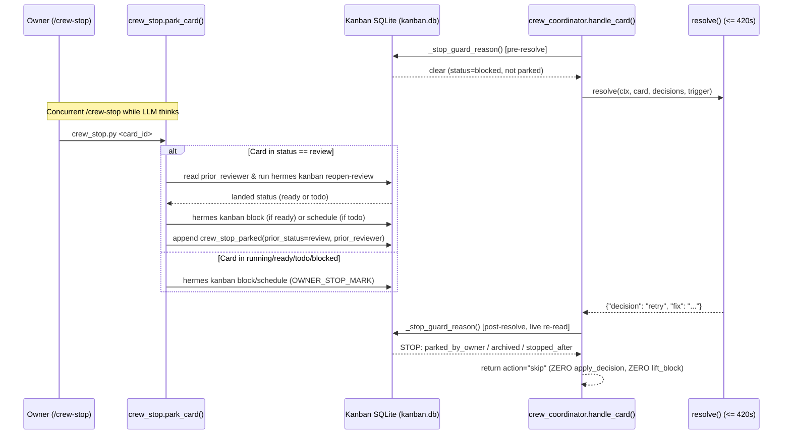

# Design: Crew & Nerve Completion, Proof-Execution, and Verdict Resilience

- **Change Slug**: `crew-nerve-completion-and-verdict-resilience`
- **Primary `OPENSPEC_ROOT`**: `O:/workspaces/oss/crew/openspec`
- **Target Repositories**: `oss/crew` (`@e6123f78b2`), `oss/hermes-nerve` (`@7b4a9b2113`)
- **Exploration**: [`explorations/2026-11-26-crew-nerve-completion-and-verdict-resilience-exploration.md`](explorations/2026-11-26-crew-nerve-completion-and-verdict-resilience-exploration.md)

---

## 1. End-to-End Architecture & Control Flow



### Coordinator Race & Review-Lane Parking Sequence (P1-4)



---

## 2. Deep-Module Technical Designs (P0-1 through P1-4)

### 2.1 P0-1 — Non-Interactive Bounded Proof Execution (`oss/crew/scripts/crew_safety.py`)

- **Seam**: `crew_safety.py::run_proof(cmd, cwd=None, timeout=300, mode="safe", card=None) -> Result` and `crew_safety.py::_exe_py_version(exe_path)`.
- **Module Reuse (`CREW-INV-7`) & Import Guard**:
  - Add a `HERE = os.path.dirname(os.path.abspath(__file__))` / `if HERE not in sys.path: sys.path.insert(0, HERE)` guard near the top of `scripts/crew_safety.py` (matching `crew_card.py:36-38` and `crew_heal.py:27-29`) before `import crew_proc`, so callers loading `crew_safety.py` without `scripts/` on `sys.path` never fail on `ModuleNotFoundError`.
  - Delegate process execution directly to `crew_proc.run_bounded(argv, timeout_s=timeout, cwd=cwd, env=proof_env(cmd=cmd))` instead of `subprocess.run(...)`.
- **Behavioral Contract**:
  1. Keep `_floors(cmd, mode)`, `script_change(card, cmd, record=True)`, and `cwd` auto-resolution unchanged before process dispatch.
  2. Construct `argv`:
     - Windows bare PowerShell (`IS_WINDOWS and detect_bare_powershell(cmd)`): `argv = [_powershell(), "-NoProfile", "-NonInteractive", "-Command", _PS_WRAPPER % cmd]`
     - Windows standard POSIX (`elif IS_WINDOWS:`): resolve `bash = git_bash()`; if missing return `Result(127, "Git Bash was not found...", "")`; `argv = [bash, "-c", cmd]`
     - POSIX (`else:`): `argv = cmd` (string passed to `run_bounded`, which sets `shell=isinstance(cmd, str)` = `True`, matching prior `shell=not IS_WINDOWS`).
  3. Execute `br = crew_proc.run_bounded(argv, timeout_s=timeout, cwd=cwd, env=proof_env(cmd=cmd))`:
     - Guarantees `stdin=subprocess.DEVNULL` on **every** OS/adapter branch.
     - Guarantees `CREATE_NEW_PROCESS_GROUP` (Windows) / `start_new_session=True` (POSIX), `CREW_RUN_MARKER` tagging, and 64 KiB `HeadTail` stdout/stderr buffering.
     - On timeout (`br.timed_out == True`), `run_bounded` already executed `terminate_tree(proc.pid, 0.5, run_marker=marker)` (`%SystemRoot%\System32\taskkill.exe /PID <pid> /T /F` + marker sweep) and returns `exit_code == 124`. `run_proof` returns `Result(124, "proof command timed out after %ss" % timeout, "")` preserving exact downstream contract.
     - On `br.exit_code == 127` with `OSError` message in `br.stderr` (cannot start), `run_proof` returns `Result(127, (br.stdout + br.stderr).strip(), "")`.
     - Otherwise returns `Result(br.exit_code, (br.stdout or "") + (br.stderr or ""), "")`.
  4. **Auxiliary Stdin Fix**: In `crew_safety.py::_exe_py_version()` (line 291), add `stdin=subprocess.DEVNULL` to `subprocess.run([norm, "-E", "-c", ...], ...)` so interpreter version probing cannot inherit a managed-worker stdin pipe either.
  5. **Existing Test Mock Seam Alignment**: `tests/test_crew_proc.py:75-93` and `tests/test_crew_safety.py:511-534` currently patch `crew_safety.subprocess.run` to assert Windows `bash.exe`/`pwsh.exe` routing and POSIX `shell=True`. Update both mock seams to patch `crew_safety.crew_proc.run_bounded` (returning `crew_proc.BoundedResult(0, "ok", "", False, 0.01, "m")` and asserting `argv` list vs `str` shell semantics) and include both suites in Slice 1 verification.
- **Why Not a Shallow Patch**: Adding only `stdin=subprocess.DEVNULL` to `subprocess.run()` leaves the Windows orphan-process leak (`proc.kill()` kills only `bash.exe`) and unbounded stdout RAM exposure intact. Reusing `crew_proc.run_bounded()` solves all three failure modes at one tested seam (`CREW-INV-7`) with minimal merge surface in hotspot file `crew_safety.py`.

---

### 2.2 P0-2 — Bounded Semantic Verification, CLI Verdict Observer & Mode Transparency (`oss/hermes-nerve`)

#### P0-2a: Deep Module `hermes_nerve/work/packet_bound.py`
- **Interface**:
  - `MAX_COMPLETION_PACKET_CHARS: int = 8000`
  - `MAX_COMPLETION_BATCHES: int = 4`
  - `safe_json_len(payload: Any) -> int` — computes `max(len(json.dumps(payload, separators=(",", ":"), allow_nan=False)), len(json.dumps(..., ensure_ascii=False)))` (exact dual-encoding discipline from `NervousSystem._safe_json_len`).
  - `bound_completion_packet(*, goal: str, remaining_criteria: list[dict[str, Any]], evidence: list[dict[str, Any]], proposal: dict[str, Any], max_chars: int = MAX_COMPLETION_PACKET_CHARS) -> dict[str, Any]`
  - `partition_completion_batches(*, goal: str, remaining_criteria: list[dict[str, Any]], evidence: list[dict[str, Any]], proposal: dict[str, Any], max_chars: int = MAX_COMPLETION_PACKET_CHARS, max_batches: int = MAX_COMPLETION_BATCHES) -> list[dict[str, Any]] | None`
- **Wrapper Token Headroom Budget (`<= 8,192` OpenJev Context Window)**:
  - `MAX_COMPLETION_PACKET_CHARS = 8000` bounds `state` directly; `DecisionEngine.verify()` (`engine.py:263-283`) + `OpenJevClient.system_one()` (`openjev.py:253-260`) add ~850 characters for `questions.decision.instructions` + `criteria` (`PASS`/`RETRY`/`REPLAN`/`ESCALATE`) plus OpenJev's fixed server prompt template (~400-600 tokens). Even under adversarial dense hex/ID payloads (~2 chars/token), `8,000 + 850 = 8,850` chars (~4,425 tokens) + server template stays comfortably below `8,192` tokens (`> 3,000` tokens of safety headroom). Tests enforce a full-request char-count sanity assertion (`safe_json_len(state) + len(instructions) <= 9500`).
- **3-Pass Deterministic Bounding Ladder** (adapted from `NervousSystem._bound_assessment_state()` at `nervous.py:2693`):
  - **Evidence Priority Ordering**: Partition evidence into (1) evidence tagged with a `criterion_id` in `remaining_criteria` or deterministic/verdict kinds (`crew_verdict`, `deterministic_check`, `tool_result` with errors/tests), newest first, followed by (2) remaining recent evidence, newest first.
  - **Pass 1 (Compact Full Context)**:
    - `goal`: truncated to `400` chars.
    - `remaining_criteria`: compact dicts (`id`, `description` truncated to `400` chars, `required`).
    - `evidence`: up to `12` priority-ordered items, each `preview` truncated to `350` chars, tracking `total_evidence_count` and `omitted_evidence_count`.
    - `proposal`: recursively bounded (`max_str=400`, `max_items=8`, `depth=2`).
    - Return immediately if `safe_json_len(packet) <= max_chars`.
  - **Pass 2 (Criterion-Linked Priority Compression)**:
    - Keep all `remaining_criteria` (descriptions capped to `220` chars).
    - Keep up to `6` highest-priority evidence items (`preview` capped to `180` chars) + `evidence_truncated: True`, `omitted_evidence_count`.
    - Compact `proposal` summary string capped to `400` chars.
    - Return immediately if `safe_json_len(packet) <= max_chars`.
  - **Pass 3 (Hard Structural Envelope — Mathematically Guaranteed `<= max_chars`)**:
    - `goal` (`160` chars), `remaining_criteria` (`id` + `120`-char description), up to `3` evidence items (`evidence_id`, `criterion_id`, `kind`, `tool_name`, `is_error`, `preview` capped to `80` chars), `proposal_summary` (`160` chars), `evidence_truncated: True`, `omitted_evidence_count`.
    - Final shrink loop trims preview/proposal/criterion lengths if needed so `safe_json_len(out) <= max_chars` holds unconditionally for any input.
- **Criterion-Grouped Batching Fallback (`partition_completion_batches`)**:
  - When a single Pass 1 packet for all `remaining_criteria` would exceed `max_chars` **and** `len(remaining_criteria) > 1`, check whether splitting `remaining_criteria` into `k` groups (`2 <= k <= MAX_COMPLETION_BATCHES`) keeps each group within Pass 1/Pass 2 without starving criterion descriptions.
  - If even `MAX_COMPLETION_BATCHES` groups cannot represent the criteria cleanly (e.g., pathological 50-criterion contract), return `None` so `verify_completion()` fails closed with `CompletionVerdict(allow=False, value="ESCALATE", reason="Unmet completion criteria exceed bounded verification batch cap.")`.
  - Inside `CardSupervisor.verify_completion()`:
    - When `evidence` is empty, return `CompletionVerdict(allow=False, value="NEEDS_EVIDENCE", ...)` immediately (existing invariant preserved).
    - Run `engine.verify(state=batch_packet, instructions=..., contract="work-completion-batch/v1")` for each batch, recording usage per batch via `_record_result_usage()`.
    - **Semantic Fidelity Guard in Instructions**: Explicitly state: *"If `evidence_truncated` is true or `omitted_evidence_count > 0` and direct proof for any listed criterion is absent from the visible packet, you MUST NOT infer or assume PASS — return NEEDS_EVIDENCE or RETRY."*
    - Only if **every** batch returns `PASS` do we record `VERIFIED_PASS` for the covered criteria. Any non-`PASS` batch (`RETRY`, `NEEDS_EVIDENCE`, `REPLAN`, `ESCALATE`) short-circuits immediately and returns `allow=False` with that verdict.

#### P0-2b: Zero-Token CLI Crew Verdict Observer (`hermes_nerve/work/deterministic.py`)
- **Seam**: `_extract_crew_verdict_call(tool_name, args, result, *, expected_task_id: str | None = None)`, `observe_crew_verdict(...)`, and `observe_test_result(...)`.
- **Recognition Rules (Fail-Closed Against Spoofing & Complete FAIL Dispatch)**:
  1. Retain existing native tool recognition (`crew_verdict`, `crew_review_handoff`, `crew_review`, and `tool_call` batches).
  2. Add CLI recognition when `tool_name.lower() in {"terminal", "terminal.exec", "shell", "bash"}`:
     - Inspect `command = str((args or {}).get("command") or (args or {}).get("cmd") or "")`.
     - Parse command tokens safely (handling Windows paths & quotes) and verify it invokes `crew_card.py` with subcommand `verdict` and explicit `--card <cid>` (or `--card=<cid>`).
     - **Strict Card-ID Binding**: If `expected_task_id` is present and `<cid> != expected_task_id`, return `(None, result)` immediately (prevents cross-card verdict spoofing).
     - Parse `rc, text = _terminal_exit(result, kwargs)` and extract `crew_card.py verdict`'s real output (`crew_card.py:2240, 2246, 2249, 2266`):
       - Primary text format: anchored line matching `^\s*verdict:\s*(PASS|FAIL)\b` (with exit codes `rc=0` for `PASS`, or `rc=1` / `rc=3` for `FAIL`), OR
       - Wrapped JSON envelope carrying `verdict` (`PASS`/`FAIL`) and `rc`/`exit_code` (and matching `card` if present).
       - Never trust bare `echo PASS` (command gate requires `crew_card.py verdict --card <cid>`).
     - Return `("crew_verdict_cli", {"verdict": parsed_verdict, "rc": parsed_rc, "card": cid})`.
  3. **Critical Dispatch & FAIL-Handling Seam Updates**:
     - Update `deterministic.py:108` inside `observe_crew_verdict()` from `if tn != "crew_verdict" and verdict != "PASS":` to:
       ```python
       if tn not in {"crew_verdict", "crew_verdict_cli"} and verdict != "PASS":
           return {"observed": False, "passed": False, "failed": False, "provider_calls": 0}
       ```
       so CLI `FAIL` verdicts (`rc=1`, `rc=3`, `verdict: FAIL`) are recorded as authoritative deterministic failures rather than silently dropped.
     - Update `deterministic.py:170` inside `observe_test_result()` from `if tn == "crew_verdict":` to:
       ```python
       tn, _ = _extract_crew_verdict_call(tool_name, args, result, expected_task_id=identity.task_id)
       if tn in {"crew_verdict", "crew_verdict_cli"}:
           return observe_crew_verdict(
               supervisor, identity, tool_name=tool_name, args=args, result=result, kwargs=kwargs
           )
       ```
       so commands like `crew_card.py verdict --card <id> --command "pytest -q"` dispatch directly to `observe_crew_verdict()` instead of being hijacked by `if "pytest" not in command` at `L177` (which would set `observed=True` and prevent `hooks.py:928` from running `observe_crew_verdict()`).
     - Pass `expected_task_id=identity.task_id` inside `observe_crew_verdict()` when calling `_extract_crew_verdict_call()`, keeping `observe_crew_verdict()`'s public signature unchanged.

#### P0-2c: Mode Precedence Transparency & Secret-Free Sidecar Hygiene
- **Preservation of `NERVE-INV-5`**: `hooks.py::pre_tool_call()` retains DoD completion gating in `shadow`, `advisory`, and `enforce` modes (matching `test_crew_dod_and_handoff.py:49-54`).
- **Precedence Visibility (`hermes_nerve/config_resolver.py`)**:
  - Add a dedicated field `advanced_override_sources: dict[str, str] = field(default_factory=dict)` to `ResolvedNerveConfig` (`config_resolver.py:13-22`) so `override_sources` remains strictly scoped to module names (`MODULES` / `control_panel.py:212` `"module_override_sources"`).
  - Inside `resolve_config()`, whenever `use_sidecar_values` is `True` and `"work_supervision_mode"` is present in `advanced` with a value differing from `getter("work_supervision_mode", None)`, record `advanced_override_sources["work_supervision_mode"] = "profile.json:advanced"`.
- **Live Profile Operational Hygiene (Commander-Gated Task)**:
  - Inspect all `$HERMES_HOME/profiles/*/nerve/profile.json` and default `nerve/profile.json` via a read-only audit script (key names only — zero secret values printed).
  - Under Commander approval: align `profiles/reviewer/nerve/profile.json` `advanced.work_supervision_mode` with `config.yaml` policy, and remove nested plaintext `advanced.reflex_openjev_token` so OpenJev authentication flows strictly through Vaultwarden-managed `.env` / environment (`HERMES_NERVE_OPENJEV_TOKEN` / `REFLEX_OPENJEV_TOKEN`).

---

### 2.3 P1-3 — Verifier-Lane vs Two-Stage Predicates & Human/Capability Block Protection (`oss/crew`)

- **Seam 1 (`scripts/crew_card.py`)**:
  - Separate the two distinct concepts cleanly (preserving `crew_card.py:974-988` standalone `Verify: agent` contract verified by `test_role_contracts.py:490-576` and `test_crew_two_stage.py:80-95`):
    ```python
    VERIFIER_VERIFY_MODES = ("independent", "agent", "dual")
    TWO_STAGE_VERIFY_MODES = ("independent", "dual")

    def uses_verifier_lane(body):
        """True when closing verdicts and verifier blocks belong to the verifier."""
        return verify_mode(body) in VERIFIER_VERIFY_MODES

    def uses_review_handoff(body):
        """True when a separate writer hands off to a verifier review lane (never standalone Verify: agent)."""
        return verify_mode(body) in TWO_STAGE_VERIFY_MODES
    ```
  - Apply each predicate strictly to its matching functions:
    - `uses_verifier_lane(body)`: `closer_profiles(body)` (`L2064`) and `verifier_block(card_id)` (`L2554`).
    - `uses_review_handoff(body)`: `hand_to_writer(card_id)` (`L2583`), `repin_for_review(card_id)` (`L1415`), and `send_to_verifier(card_id, summary)` (`L2024`).
    - On standalone `Verify: agent` cards (`Role: verifier`), `hand_to_writer()` returns `{"reopened": False, "assigned": ""}` without reassigning to `crew-worker`.
- **Seam 2 (`scripts/crew_heal.py`)**:
  - Define:
    ```python
    NON_HEALABLE_BLOCK_KINDS = frozenset({"needs_input", "capability"})

    def _card_block_kind(card):
        kind = str(card.get("block_kind") or "").strip().lower()
        if kind:
            return kind
        cid = card.get("id")
        if cid and os.path.exists(KANBAN_DB):
            try:
                rows = q("select block_kind from tasks where id = ?", (cid,))
                if rows:
                    return str(rows[0].get("block_kind") or "").strip().lower()
            except Exception:
                return ""
        return ""
    ```
  - Enforce in **both** `heal_card()` (before invoking `heal_stale_verify`) and `heal_stale_verify()` (defense-in-depth for direct callers):
    ```python
    if _card_block_kind(card) in NON_HEALABLE_BLOCK_KINDS:
        return None
    ```
  - **Existing Test Alignment (`tests/test_crew_verifier_block.py`)**: Update `blocked_card(self, by_verifier=True, body=BODY, kind="needs_input")` to allow passing `kind="transient"` in `test_a_stale_block_that_is_not_the_verifiers_still_heals` and `test_a_proof_card_blocked_by_its_verifier_run_still_heals`, and add new explicit tests asserting:
    1. `Verify: dual` verifier blocks are recognized by `verifier_block()`, refused by `heal_card()`, and handed back to the writer by `hand_to_writer()`.
    2. Standalone `Verify: agent` (`Role: verifier`) verifier blocks are recognized by `verifier_block()` and refused by `heal_card()`, while `hand_to_writer()` remains a no-op leaving the card assigned to the verifier profile.
    3. `block_kind="needs_input"` and `block_kind="capability"` blocks are NEVER healed by `heal_card()` / `heal_stale_verify()` even when `card` dict omits `"block_kind"` and `run_proof` would return `rc=0`.

---

### 2.4 P1-4 — Post-Resolve Stop Guard & Review-Lane Parking (`oss/crew`)

#### P1-4a: Coordinator Post-Resolve Stop Guard (`scripts/crew_coordinator.py`)
- **Seam**: Extract `_stop_guard_reason(ctx, card_id, newest_event_id) -> str`:
  ```python
  def _stop_guard_reason(ctx, card_id, newest_event_id):
      live = get_card(ctx, card_id)
      if not live:
          return "no such card"
      if live["status"] in ("archived", "done"):
          return live["status"]
      if crew_card.parked_by_owner(ctx.db, card_id):
          return "stopped by the owner (/crew-stop): no decision until /crew-unstuck"
      if newest_event_id is not None and stopped_after(ctx, card_id, newest_event_id):
          return "stopped by the owner"
      return ""
  ```
- **Call Sites in `handle_card(ctx, card_id, events)`**:
  1. **Pre-`resolve()`** (lines 960-969): invoke `_stop_guard_reason(ctx, card_id, newest["id"])`; if non-empty, return `out` with `action="skip"`, `detail=reason`.
  2. **Post-`resolve()`, immediately before `apply_decision()`** (between lines 1002 and 1003): invoke `post_stop = _stop_guard_reason(ctx, card_id, newest["id"])`; if non-empty, return `out` with `action="skip"`, `detail="%s (detected after resolve)" % post_stop` — **neither** calling `apply_decision()` **nor** recording an applied `retry` event!

#### P1-4b: Review-Lane Non-Destructive Parking (`scripts/crew_stop.py` & `tests/kernel_board.py`)
- **Seam (`scripts/crew_stop.py::park_card(card_id, dry)`)**:
  - Read `row = (q("select status, assignee from tasks where id = ?", (card_id,)) or [{"status": "?", "assignee": ""}])[0]`.
  - When `status == "review"`:
    - If `dry`: return `"would reopen-review + park", ""`.
    - Run `hermes kanban reopen-review <card_id>` (via `subprocess.run` with `HERMES_KANBAN_DB=KANBAN_DB`).
      - If `returncode != 0`: return `"reopen-review refused", output`.
    - Re-read post-reopen status from `KANBAN_DB`: `landed = (q("select status from tasks where id = ?", (card_id,)) or [{"status": "?"}])[0]["status"]`.
    - Select parking verb for `landed`:
      - `landed == "ready"` -> `argv = ["block", card_id, "--kind", park_kind(card_id), reason]`
      - `landed == "todo"` -> `argv = ["schedule", card_id, reason]`
      - else -> return `"cannot park a %s card after reopen-review" % landed, ""`
    - Run `hermes kanban <argv>`, retrying once (after a short `0.2s` backoff) on non-zero returncode to absorb transient SQLite lock contention.
    - If `returncode == 0`: append audit provenance via `crew_card._append_card_event(card_id, "crew_stop_parked", {"prior_status": "review", "prior_reviewer": row.get("assignee") or "", "landed_status": landed, "park_verb": argv[0]}, db=KANBAN_DB)` (best-effort, non-fatal if event table unavailable) and return `"reopen-review+%s" % argv[0], output`.
    - `stop_card()` returns `facts["parked"] = (not archive and ok)` (exposed by `native_tools.py:831-838` as `facts.parked: true` alongside top-level `status: "ok"`, `stopped: true`).
- **Test Harness Seam (`tests/kernel_board.py::kernel_cli`)**:
  - Add `elif verb == "reopen-review": ok = kb.reopen_review_task(conn, cid)` so `tests/test_crew_stop_park.py` tests real kernel `review -> ready -> blocked` and parent-gated `review -> todo -> scheduled` transitions end-to-end.

---

## 3. Negative Impact Analysis (3 Worst-Case Unintended Side-Effects & Mitigations)

| # | Worst-Case Unintended Side-Effect | Blast Radius | Concrete Mitigation |
| :--- | :--- | :--- | :--- |
| **1** | **False `RETRY`/`NEEDS_EVIDENCE` Loops from Over-Truncated Completion Packets (P0-2a)**: If Pass 2/Pass 3 truncates the exact preview snippet proving a prose DoD criterion, OpenJev/Jev returns `RETRY` repeatedly and burns worker turns. | All Nerve-supervised Crew cards with large evidence logs (`> 12` tool calls). | (a) Priority-sort evidence so `criterion_id`-linked items, `crew_verdict`, and `deterministic_check` evidence always sit at the head of Pass 1/Pass 2; (b) invoke criterion-grouped sub-batching (`<= 4` batches) before collapsing to Pass 3; (c) CLI `crew_card.py verdict` deterministic recognition (`P0-2b`) removes verdict criteria from semantic verification entirely (`provider_calls == 0`). |
| **2** | **Stale Blocked Cards Staying Stuck Because of `block_kind="needs_input"` (P1-3)**: Cards that previously got auto-rescued by `heal_stale_verify` despite having `block_kind="needs_input"` (e.g., transient errors misclassified as `needs_input` by a worker) will now wait for coordinator/owner decision instead of self-healing. | Blocked cards with `block_kind="needs_input"` or `"capability"`. | This is the intended safety boundary (preventing silent bypass of Commander/verifier gates). Coordinator `resolve()` still runs immediately on `blocked` cards when `heal_card()` returns `None`, so non-human misclassified blocks still receive bounded coordinator triage (`retry` or `ask_owner`) without stalling silently. Legacy tests in `test_crew_verifier_block.py` are updated to `kind="transient"` for true stale blocks. |
| **3** | **`reopen-review` Succeeds but Subsequent `block`/`schedule` Fails Partially (P1-4b)**: If `hermes kanban reopen-review` transitions `review -> ready` and the immediate `hermes kanban block` fails (e.g. SQLite busy timeout), the card could momentarily sit in `ready` (dispatchable) instead of `review` or `blocked`. | Review-lane cards stopped during heavy concurrent DB contention. | (a) `stop_card()` already re-reads `after = snapshot(card_id)` and checks `ok = (after[0] == "scheduled" or (after[0] == "blocked" and parked_by_owner(...)))`; any partial failure immediately surfaces `NOT DOWN` and exit code `1` (fail-loud, never false green); (b) `park_card()` retries the follow-up `block`/`schedule` once after `0.2s` backoff on transient failure before reporting `refused`, and records `crew_stop_parked` provenance so operators immediately see the prior `review` lane and reviewer. |

---

## 4. Architecture Updates (Phase 5 Post-Archive Sync Inventory)

Upon archiving this change, Phase 5 Post-Archive Sync MUST update or flag the following documentation and knowledge planes:

- **KB Blast-Radius Documents (Touchpoint 3 Refresh Checklist)**:
  1. `archify:archify-10e2146b1002d340` — *"How did we unify OpenSpec, Nerve, Crew, and Kanban DoD gates?"* (add bounded `<= 8,000`-char `packet_bound.py` completion contract, CLI `crew_card.py verdict` zero-token observation, separated `uses_verifier_lane()` / `uses_review_handoff()` predicates, and `needs_input`/`capability` heal guard).
  2. `archify:archify-efa5f5e971561f18` — *"How did we stop System One timeouts and zombie failovers?"* (cross-reference reuse of `_bound_assessment_state()`'s 3-pass `8,000`-char bounding ladder in `hermes_nerve/work/packet_bound.py`).
  3. 2-Hop Neighbor Docs to spot-check for stale references:
     - `workspaces-docs:hermes-skills-workflows-plugins`
     - `workspaces-docs:antigravity-hermes-architecture`
     - `workspaces-docs:hermes-control-architecture`
- **Graphify JIT HEAD Verified AST Seams (`oss/crew@e6123f78b2`, `oss/hermes-nerve@7b4a9b2113`)**:
  - `oss/crew`: `crew_safety.py::run_proof()` -> `crew_proc.py::run_bounded()`, `crew_card.py::uses_verifier_lane()` -> `{closer_profiles, verifier_block}`, `crew_card.py::uses_review_handoff()` -> `{hand_to_writer, repin_for_review, send_to_verifier}`, `crew_heal.py::heal_card()` / `heal_stale_verify()`, `crew_coordinator.py::handle_card()` -> `_stop_guard_reason()`, `crew_stop.py::park_card()`.
  - `oss/hermes-nerve`: `work/packet_bound.py::bound_completion_packet()` <- `work/supervisor.py::CardSupervisor.verify_completion()`, `work/deterministic.py::observe_crew_verdict()` / `_extract_crew_verdict_call()` / `observe_test_result()`, `config_resolver.py::resolve_config()`.
  - Phase 5 dispatches non-blocking `pwsh O:/workspaces/ai_agents/hermes-agent/scripts/build-graphify-workspace.ps1 -TargetPath <repo> -SyncToNuc -SpawnTab` for both `oss/crew` and `oss/hermes-nerve` after code lands.

---

## 5. Deployment & §9 Zero-Checkout Worktree Plan

Per `AGENTS.md` §9 and `openspec/specs/worktree-isolation-governance/spec.md`:

1. **Isolated Development Worktrees** (primary checkouts `O:/workspaces/oss/crew` and `O:/workspaces/oss/hermes-nerve` remain strictly untouched on `main`):
   - Crew worktree: `O:/workspaces/.worktrees/wt-crew-resilience` (branch `fix/crew-resilience`)
   - Nerve worktree: `O:/workspaces/.worktrees/wt-nerve-resilience` (branch `fix/nerve-resilience`)
2. **Publication from Worktrees**:
   - After all TDD tests, proof scripts, watchdog `-GateOnly` checks, and `git diff --check` pass, push directly from worktrees (`git -C <worktree> push origin HEAD:main`).
3. **Commander-Gated Live Cutovers**:
   - **Crew Cutover (7 profiles + Desktop hot-reload)**:
     `pwsh -NoProfile -File O:/workspaces/_config/agent4070/hermes/services/apply-live-crew-cutover.ps1 -ExpectedSha <crew_sha>`
     (fast-forwards `O:/workspaces/oss/crew` `--ff-only`, syncs all 7 profiles + `desktop-plugins/crew/`, verifies SHA-256 parity, preserves runtime data).
   - **Nerve Cutover (git-aligned plugin target)**:
     `pwsh -NoProfile -File O:/workspaces/_config/agent4070/hermes/services/apply-live-nerve-cutover.ps1 -ExpectedSha <nerve_sha>`
     (fast-forwards `O:/workspaces/oss/hermes-nerve` `--ff-only`, syncs tracked files to `_config/agent4070/hermes/plugins/nerve`, aligns submodule HEAD via local fetch + mixed reset, verifies SHA-256 parity).
   - **Live Profile Secret & Mode Hygiene**: Back up `O:/workspaces/_config/agent4070/hermes/profiles/reviewer/nerve/profile.json`, remove nested plaintext `advanced.reflex_openjev_token` (verify env/Vaultwarden source), align `advanced.work_supervision_mode` per Commander decision, and verify zero plaintext secret keys across all 7 profiles.
   - **Manual Daemon Reload**: Neither cutover script restarts Hermes Gateway (`:8642`) or Hermes Dashboard (`:9119`); surface any `MANUAL:` restart lines to the Commander.

---

## 6. Watchdog Invariant Updates (`crew-upstream-sync` & `nerve-upstream-sync`)

1. **`O:/workspaces/.agents/skills/crew-upstream-sync/` (`daily-sync-watchdog.ps1` + `SKILL.md`)**:
   - Extend `CREW-INV-7` (or add `CREW-INV-9: Proof Stdin/Tree, Verifier-Lane Heal Guard & Stop-Race Resilience`):
     - **Static Anchors**: `crew_proc.run_bounded(` in `scripts/crew_safety.py`; `VERIFIER_VERIFY_MODES`, `TWO_STAGE_VERIFY_MODES`, `def uses_verifier_lane(`, and `def uses_review_handoff(` in `scripts/crew_card.py`; `NON_HEALABLE_BLOCK_KINDS` in `scripts/crew_heal.py`; `def _stop_guard_reason(` in `scripts/crew_coordinator.py`; `"reopen-review"` in `scripts/crew_stop.py`.
     - **Invariant Tests**: Add `tests/test_crew_run_proof_resilience.py`, `tests/test_crew_verifier_block.py`, and `tests/test_crew_stop_park.py` to `$InvariantTests`.
2. **`O:/workspaces/.agents/skills/nerve-upstream-sync/` (`daily-sync-watchdog.ps1` + `SKILL.md`)**:
   - Add **`NERVE-INV-8: Bounded Completion Packet & CLI Crew Verdict Observer`** (preserving `NERVE-INV-1..7`):
     - **Static Anchors**: `MAX_COMPLETION_PACKET_CHARS = 8000` & `def bound_completion_packet(` in `hermes_nerve/work/packet_bound.py`; `bound_completion_packet` / `partition_completion_batches` in `hermes_nerve/work/supervisor.py`; `crew_verdict_cli` in `hermes_nerve/work/deterministic.py`; `advanced_override_sources` in `hermes_nerve/config_resolver.py`.
     - **Behavioral Probe (`$ProbeCode`)**: Pass a 45,000-char synthetic packet (`24` evidence entries x `1,500` chars + `12,000`-char proposal) through `bound_completion_packet(...)` and assert `safe_json_len(out) <= 8000` and `out["evidence_truncated"] is True`.
     - **Invariant Tests**: Add `tests/test_completion_packet_and_cli_verdict.py` to `$InvariantTests` alongside `tests/test_crew_dod_and_handoff.py` (`NERVE-INV-5`).
